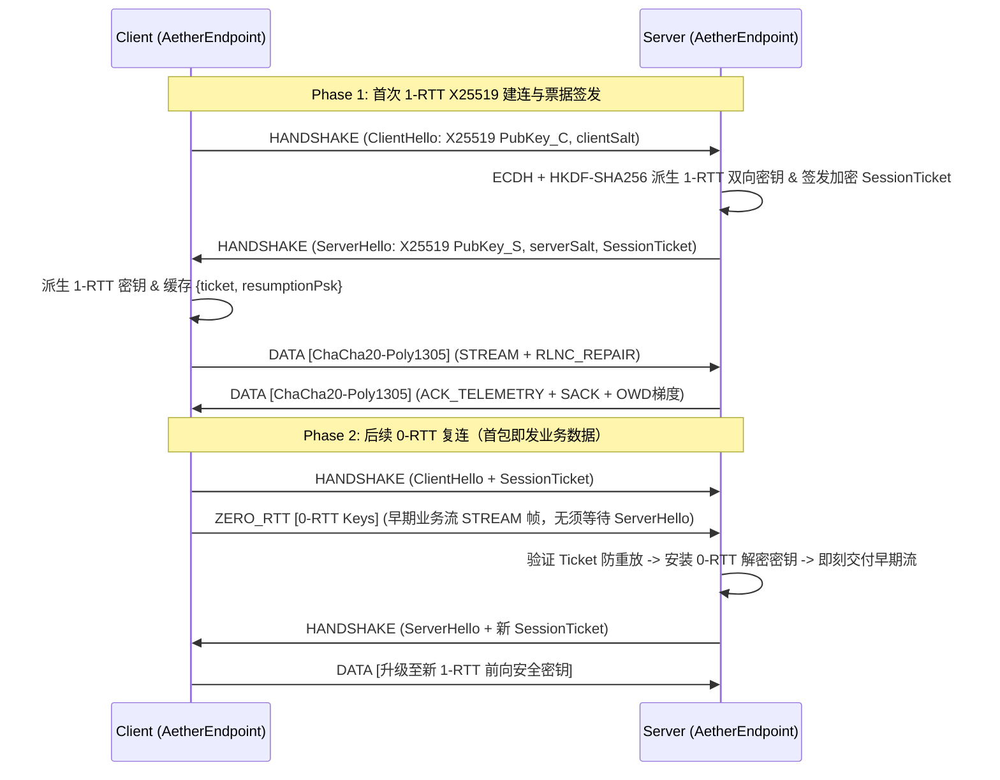
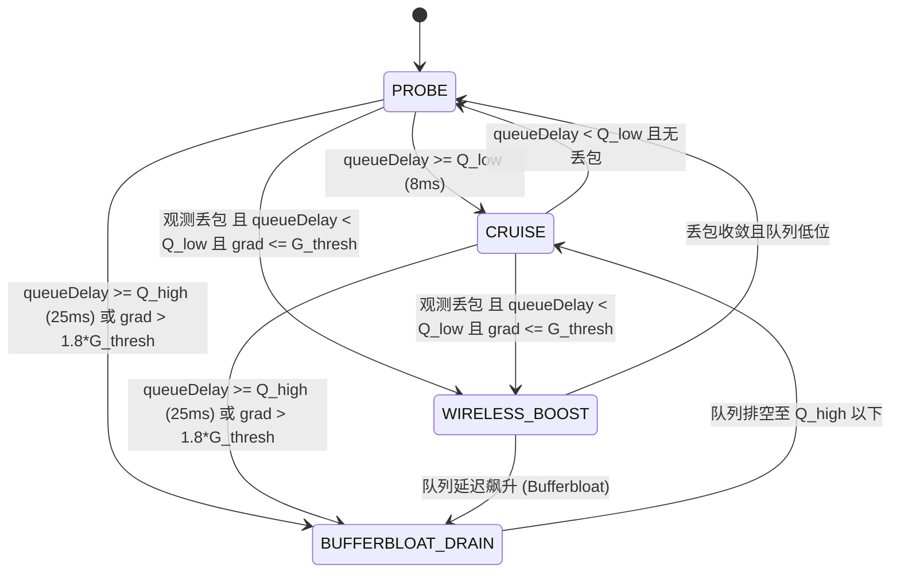

# RFC-DRAFT-AETHER-W6: 面向高算力终端与受限 Wi-Fi 6 链路的自适应弹性传输协议规范

> **文档状态**：Experimental Protocol Specification & Verified Reference Prototype (`v1.0`)
> **协议全称**：**AETHER-W6** (*Adaptive Entropy-aware Transport with Hybrid Erasure-coding & Resilient-control for Wi-Fi 6*)
> **目标宿主实测画像**：Windows 11 x64（16 逻辑核）| `WLAN` Realtek RTL8852BE Wi-Fi 6 (802.11ax) | 当前物理协商速率 **173.3 Mbps** | **纯 IPv4**（无 IPv6）| **MTU = 1500 B** | 单默认网关
> **参考实现底座**：零外部依赖纯 **Node.js v24.21.0** ESM（`node:dgram`, `node:crypto`, `node:zlib`, `node:worker_threads`, `node:perf_hooks`）

---

## 1. 设计动机与宿主环境不对称性分析

传统传输协议（如 TCP Reno/CUBIC）在有线光纤时代基于两个隐含假设：**丢包即拥塞**、**端点算力稀缺**。然而在实测的宿主网络环境中，这两个假设均已失效：

1. **无线链路的不确定性**：当前 `WLAN` 活跃接口为 Realtek RTL8852BE Wi-Fi 6，协商速率仅 **173.3 Mbps**（窄频宽/受限 MCS 无线信道），天然伴随 CSMA/CA 空口竞争引起的微突发抖动、相关性突发丢包（Gilbert-Elliott 过程）、乱序到达以及无线路由器深队列 Bufferbloat。传统 TCP 遇无线丢包即触发 `cwnd` 减半与 1+ RTT 重传停顿，单流字节序模型还会导致一帧丢包阻塞全部并发逻辑流（Head-of-Line Blocking）。
2. **极端的算力带宽倒挂**：主机具备 **16 核 x64 算力**，而活跃无线链路仅 **173.3 Mbps**。实测表明，本机在纯 JavaScript 环境下即可将 $\text{GF}(2^8)$ 滑动窗口随机线性网络编码（RLNC）推至 **947.35 Mbps**（约为无线链路的 **5.47 倍**）。

**AETHER-W6 的核心工程哲学**：以终端富余的 CPU 算力与内存为代价，通过**系统滑动窗口 RLNC 前向纠删**、**卡尔曼延迟梯度无线丢包解耦**、**多流 HoL 隔离**、**香农熵门控原生 Zstd 压缩**及 **0-RTT AEAD 加密**，在合法传输层边界内将高丢包、高抖动无线链路重塑为低尾延迟的高韧性通道。

---

## 2. 协议分层架构与交互状态机

### 2.1 四层协议栈数据流

### 2.2 1-RTT 建连与 0-RTT 复连时序

### 2.3 无线丢包解耦拥塞控制状态机

---

## 3. 二进制 Wire Format 规范

### 3.1 纯 IPv4 MTU=1500 安全字节预算

| 封装层级 | 字节预算 | 累计字节 | 设计考量 |
| :--- | :---: | :---: | :--- |
| 外层 IPv4 Header | 20 B | 20 B | 当前活跃 WLAN 为纯 IPv4 栈 |
| 外层 UDP Header | 8 B | 28 B | 无连接低开销承载 |
| **AETHER-W6 Packet Header (AAD)** | **16 B** | **44 B** | 16 字节对齐，直接作为 AEAD 附加认证数据防篡改 |
| **AETHER-W6 Plaintext Frames** | **≤ 1348 B** | **≤ 1392 B** | 支持多帧机会主义聚合（Coalescing） |
| **ChaCha20-Poly1305 Auth Tag** | **16 B** | **≤ 1408 B** | 128-bit Poly1305 完整性校验 |
| **安全隧道/封装余量** | **92 B** | **1500 B** | 规避 PPPoE / GRE / VXLAN / NAT 链路上的 IPv4 分片 |

### 3.2 定长 16 B 数据报包头（Big-Endian，作为 AEAD AAD）

| 偏移 | 长度 | 字段名 | 位图 / 语义定义 |
| :---: | :---: | :--- | :--- |
| `0` | 1 B | `VerFlags` | `[7:4]` Version (`0x1`)；`[3]` KeyPhase；`[2]` Is0RTT；`[1]` Coalesced；`[0]` Reserved (`0`) |
| `1` | 1 B | `PktType` | `0x01`: `DATA`；`0x02`: `HANDSHAKE`；`0x03`: `ZERO_RTT`；`0x04`: `PROBE` |
| `2..3` | 2 B | `PayloadLen` | `uint16`，加密载荷长度（不含末尾 16 B AuthTag，上限 `1348`） |
| `4..7` | 4 B | `ConnID` | `uint32`，连接标识，支持无线漫游或 NAT 端口重绑定后会话无感续传 |
| `8..11` | 4 B | `PacketNum` | `uint32`，严格单调递增包号，参与 12 B ChaCha20 Nonce 构造 |
| `12..15` | 4 B | `TxTimeUs` | `uint32`，发送相对微秒时间戳（`performance.now() * 1000` 取模 $2^{32}$），驱动接收端单向延迟梯度估算 |

### 3.3 自包含 `STREAM` 符号体与五大核心帧

> [!IMPORTANT]
> **RLNC 元数据自包含设计**：`STREAM` 帧把 `FrameFlags(1B) | StreamID(2B) | StreamOffset(4B) | DataLen(2B) | Payload(L B)` 整体作为 RLNC 编码符号体（上限 `1328 B`，其中有效载荷上限 `1319 B`）。即使原始系统包完全丢失，接收端仅靠 `RLNC_REPAIR` 高斯消元恢复出字节向量后，即可依据内嵌 `DataLen` 自动剔除尾随零填充并无损还原 `StreamID`、`FIN`、`ZSTD` 标志与真实载荷。

| 帧类型 | `FrameType` | 二进制字段布局 | 最大长度约束 |
| :--- | :---: | :--- | :---: |
| **`STREAM`** | `0x10` | `Type(1) \| SourceSeq(4) \| [Flags(1) \| StreamID(2) \| StreamOffset(4) \| DataLen(2) \| Payload(L)]` | `5 + 9 + L <= 1333 B` |
| **`RLNC_REPAIR`** | `0x20` | `Type(1) \| Flags(1) \| WinStart(4) \| WinLen(2) \| PrngSeed(4) \| SymbolLen(2) \| CodedSymbol(S)` | `14 + S <= 1342 B` |
| **`ACK_TELEMETRY`** | `0x30` | `Type(1) \| SackWords(1) \| LargestAckedPkt(4) \| AckDelayUs(4) \| CumSourceSeq(4) \| RecvOwdGrad(2) \| SackBitmap(4N)` | `N <= 8`（覆盖 256 包） |
| **`HANDSHAKE`** | `0x40` | `Type(1) \| Flags(1) \| EphemeralPubKey(32) \| NonceSalt(16) \| TicketLen(2) \| SessionTicket(T)` | `52 + T B`（标准票据 `T=72 B`） |
| **`PING`** | `0x50` | `Type(1) \| Flags(1) \| PingId(4) \| TimestampUs(4)` | 固定 `10 B` |

---

## 4. 核心数学与算法模型

### 4.1 有限域 $\text{GF}(2^8)$ 查表算术与系统滑动窗口 RLNC

- **有限域构造**：采用本原多项式 $P(x) = x^8 + x^4 + x^3 + x^2 + 1$（`0x11d`）与生成元 $\alpha = 2$。启动时预计算双倍长 `GF_EXP[512]`、`GF_LOG[256]`、`GF_INV[256]` 及扁平化 **64 KB `GF_MUL_TABLE[65536]`**（契合 L1/L2 缓存，消除热循环分支）。
- **无系数头膨胀修复包**：发送端维护活跃滑动窗口 $W = [s_{\text{start}}, s_{\text{start}} + w - 1]$（上限 `48` 符号）。生成修复符号时仅在包头携带 4 字节 `PrngSeed`，双端通过 `xorshift32` 生成确定性非零系数向量 $c_i \in \{1,\dots,255\}$，在线性组合时将短符号隐式零填充对齐：

$$R = \bigoplus_{i=0}^{w-1} \left( c_i \otimes_{\text{GF}(2^8)} S_{s_{\text{start}}+i} \right)$$

- **增量在线高斯-约当消元（OFGE / RREF）**：接收端维护稀疏最简行阶梯主元表 `pivots`（以最小未知 `SourceSeq` 为主元，主元系数归一化为 `1`）。每到达一个系统包或修复包，立即执行已知符号代入、前向消元、主元归一化与向后回代；一旦任意子方程化简至单未知项，立即级联解出并向上层多流复用器交付，无须等待整块收齐或 1 RTT 重传。

### 4.2 二维卡尔曼延迟梯度滤波与无线丢包解耦

以相对单向延迟残差 $z_k = \max\left(0,\; \text{OWD}_k - \min_{\tau \in [t-10\text{s}, t]} \text{OWD}_\tau\right)$ 抵消双端时钟静态偏移，追踪二维状态向量 $\mathbf{x}_k = [d_q,\; \dot{d}_q]^T$（排队延迟及其变化率）：

$$\hat{\mathbf{x}}_{k|k-1} = \begin{bmatrix} 1 & \Delta t \\ 0 & 1 \end{bmatrix} \hat{\mathbf{x}}_{k-1}, \qquad \mathbf{K}_k = \mathbf{P}_{k|k-1}\mathbf{H}^T \left(\mathbf{H}\mathbf{P}_{k|k-1}\mathbf{H}^T + R\right)^{-1}, \qquad \mathbf{H} = [1,\; 0]$$

- **无线丢包归因判别**：当 SACK 观测到丢包率 $p_{\text{eff}} > 0$ 且估算排队延迟 $d_q < Q_{\text{low}}$（默认 `8 ms`）、延迟梯度 $\dot{d}_q \le G_{\text{thresh}}$（默认 `18 ms/s`）时，判定为**无线随机/突发丢包**：保持 `cwnd` 不缩减，转入 `WIRELESS_BOOST`，结合估测突发长度 $\bar{B}$ 动态抬升 RLNC 冗余率：

$$\rho = \text{clamp}\left(\frac{p_{\text{eff}}}{\max(0.05,\; 1 - p_{\text{eff}})} \cdot \left(1 + 0.35\sqrt{\bar{B}}\right) + 0.06,\;\; 0.05,\;\; 0.75\right)$$

- **Bufferbloat 主动排空**：当 $d_q \ge Q_{\text{high}}$（`25 ms`）或 $\dot{d}_q > 1.8 G_{\text{thresh}}$ 时进入 `BUFFERBLOAT_DRAIN`，温和收缩 `cwnd`（`×0.85`）与发送速率（`×0.75`）排空路由器队列。

### 4.3 香农熵门控原生 Zstd 压缩

对每个长度 $\ge 64\text{ B}$ 的流分片执行单趟 256 桶字节频次统计，计算香农熵：

$$H(X) = -\sum_{b=0}^{255} p(b)\log_2 p(b) \in [0, 8]$$

仅当 $H(X) < 7.2\text{ bits/byte}$ 且 Node.js v24 原生 `zlib.zstdCompressSync(level=2)` 输出严格小于原文长度时启用压缩并置位 `STREAM_FLAGS.ZSTD`；已压缩视频/图片/加密高熵流直接零拷贝透传，规避负压缩与 CPU 空转。

### 4.4 0-RTT / 1-RTT 加密与防重放安全层

- **密钥交换与派生**：采用 `X25519` ECDH + `HKDF-SHA256` 独立派生 `c2s` 与 `s2c` 双向 `32 B Key + 12 B IV`。
- **AEAD 封装**：`ChaCha20-Poly1305`（16 B Tag），16 B Packet Header 作为 AAD；12 B Nonce 由静态 `IV` 与 `[DirByte(1B) || KeyPhase(1B) || 0(6B) || PacketNum(4B)]` 异或构造。
- **0-RTT 票据防重放**：服务端以独立主密钥 AEAD 封装 `72 B SessionTicket`（含 `32 B PSK + 8 B expiresAtMs + 4 B ticketId`），消费时校验 TTL 并将 `ticketId` 写入防重放集合，重复提交自动拒绝并安全降级回完整 1-RTT。

---

## 5. 零依赖 Node.js v24.21.0 参考实现清单

参考实现按标准零依赖 ESM 工程结构组织于本仓库 `src/`、`test/`、`bench/` 目录：

- [01-gf256.mjs](../src/01-gf256.mjs) — $\text{GF}(2^8)$ (`0x11d`) 64 KB 查表算术、`mulAddRow`/`scaleRow` 与 `xorshift32`
- [02-rlnc-codec.mjs](../src/02-rlnc-codec.mjs) — 系统滑动窗口 `RlncEncoder` 与稀疏 RREF 在线高斯消元 `RlncDecoder`
- [03-wire-format.mjs](../src/03-wire-format.mjs) — 16 B Header、自包含 `STREAM` 符号体与 5 类帧编解码及 1380 B MTU 守卫
- [04-crypto-0rtt.mjs](../src/04-crypto-0rtt.mjs) — `X25519`、`HKDF-SHA256`、`ChaCha20-Poly1305` 与 `SessionTicketManager`
- [05-entropy-zstd.mjs](../src/05-entropy-zstd.mjs) — 香农熵快速计算与 Node v24 原生 `zstdCompressSync`/`zstdDecompressSync`
- [06-cc-kalman.mjs](../src/06-cc-kalman.mjs) — `KalmanDelayFilter`、`WirelessCongestionCtrl` 与高精度 `MicroPacer`
- [07-stream-mux.mjs](../src/07-stream-mux.mjs) — 多流 HoL 隔离重排与优先级赤字加权轮询（DWRR）调度
- [08-aether-endpoint.mjs](../src/08-aether-endpoint.mjs) — 基于 `node:dgram` 的双端 UDP 协议状态机、0-RTT 握手、SACK 与 ARQ 兜底
- [worker-rlnc.mjs](../src/worker-rlnc.mjs) — `worker_threads` 多核并行 $\text{GF}(2^8)$ RLNC 编码基准
- [test-unit.mjs](../test/test-unit.mjs) — 8 项核心算法与端到端 UDP 自动化自测
- [09-chaos-bench.mjs](../bench/09-chaos-bench.mjs) — `Wifi6ChaosProxy` 弱网混沌代理、同信道 `TcpRenoOverUdpRef` 与四场景基准套件（结果固化于 [bench-results.json](../bench/bench-results.json)）

---

## 6. 实测验证与 Wi-Fi 6 四场景弱网混沌对比报告

### 6.1 单元与端到端集成自测（`node test-unit.mjs`，退出码 `0`，总耗时 `20.60 ms`）

| 编号 | 验证项 | 耗时 | 实测关键断言结果 |
| :---: | :--- | :---: | :--- |
| `#1` | $\text{GF}(2^8)$ 域公理与向量化行运算 | 0.66 ms | 1..255 全量乘法逆元校验、512 组分配律/交换律、`mulAddRow`/`scaleRow` 一致 |
| `#2` | 滑动窗口 RLNC 31.25% 突发丢包恢复 | 3.15 ms | 32 个变长 `STREAM` 符号丢弃 10 个（含连续 5 包突发），投喂 12 个修复包全部逐字节还原 |
| `#3` | Wire Format 往返与 MTU 越界守卫 | 0.96 ms | Header + 5 类帧编解码往返一致，超 `MAX_PLAINTEXT=1348` 准确抛出 `RangeError` |
| `#4` | 0-RTT/1-RTT 加解密、AAD 篡改与防重放 | 3.46 ms | X25519 密钥一致、1-bit 包头或密文篡改均抛错拒收、Ticket 二次重放被拦截 |
| `#5` | 香农熵门控原生 Zstd 压缩/直通 | 0.90 ms | 低熵文本（$H=4.44$）`1361 B -> 188 B` 无损还原；高熵随机流（$H=7.83$）`1200 B` 直通零膨胀 |
| `#6` | 卡尔曼滤波与无线丢包归因 | 1.10 ms | 低队列丢包触发 `WIRELESS_BOOST`（`cwnd=155860 B` 不降、$\rho$ 升至 `0.32`）；队列膨胀触发 `BUFFERBLOAT_DRAIN`（`cwnd` 收缩至 `46857 B`） |
| `#7` | 多流 HoL 隔离与优先级加权调度 | 1.04 ms | Stream 1 缺失 offset 0 时 Stream 2 即时完成；`priority=7` vs `0` 出队比达 `21:3` |
| `#8` | 真实本机 UDP 1-RTT + 0-RTT 端到端传流 | 8.93 ms | 1-RTT（`12296 B`）拿票后，0-RTT 携带早期流（`4500 B`, `zeroRttRx=4`）逐字节验证一致 |

### 6.2 Wi-Fi 6 四场景弱网混沌对比压测（`node 09-chaos-bench.mjs`，退出码 `0`）

- **测试负载**：8 路并发混合业务流，总原始有效载荷 **244,354 B（238.6 KB）**——含 4 路低熵 JSON 业务流（~152 KB）、2 路高熵不可压缩随机媒体流（84 KB）、2 路高优先级（`priority=7`）控制流（4 KB）。
- **公平对照口径**：AETHER-W6 与 RFC 6298/5681 语义的包级 `TcpRenoOverUdpRef`（含 3 DupACK 快速重传、RTO 指数退避与推进复位、单流顺序 HoL 交付）均运行在**同一套 `Wifi6ChaosProxy` 双向 UDP 混沌信道**上，且所有场景均通过逐字节载荷一致性校验。

| 场景 | 总耗时 AETHER / TCP (ms) | 有效吞吐 AETHER / TCP (Mbps) | 吞吐提升倍率 | P50 / P99 FCT AETHER (ms) | P50 / P99 FCT TCP-Reno (ms) | 高优控制流 FCT AETHER / TCP (ms) | 实测丢包率 A / T | RLNC 恢复 / ARQ 兜底 | 熵压缩节省率 |
| :--- | :---: | :---: | :---: | :---: | :---: | :---: | :---: | :---: | :---: |
| **S1 正常 Wi-Fi 轻抖动** | 182.4 / 1155.8 | **10.72** / 1.69 | **6.34x** | 140.6 / **182.4** | 1124.9 / 1155.8 | **18.0** / 42.9 | 0% / 0.25% | 15 / 0 | 55.89% |
| **S2 10% 随机无线丢包** | 280.5 / 6794.0 | **6.97** / 0.29 | **24.03x** | 278.7 / **280.5** | 5955.8 / 6794.0 | **16.7** / 72.8 | 11.05% / 11.96% | 29 / 2 | 55.89% |
| **S3 20% GE 突发丢包+乱序** | 251.3 / 14411.7 | **7.78** / 0.14 | **55.57x** | 234.8 / **251.3** | 14360.7 / 14411.7 | **40.2** / 78.3 | 16.11% / 15.88% | 45 / 3 | 55.89% |
| **S4 高 Bufferbloat 队列膨胀** | 220.7 / 1131.6 | **8.86** / 1.73 | **5.12x** | 186.9 / **220.7** | 1081.9 / 1131.6 | **22.4** / 64.6 | 4.59% / 3.33% | 8 / 0 | 55.89% |

### 6.3 关键实测现象与客观工程解读

1. **突发丢包下的结构性代差（S2 / S3）**：在 16% 实测 Gilbert-Elliott 突发丢包 + 8% 乱序（S3）下，TCP-Reno 遭遇 `42` 次 RTO 停顿与 `cwnd` 反复塌缩，耗时飙升至 **14.4 秒**；AETHER-W6 准确归因 `18` 次无线丢包且 `0` 次误判拥塞，将冗余率 $\rho$ 动态拉升至 `0.75`，依靠滑动窗口 RLNC 原地解出 **45 个丢失符号**（仅需 `3` 次选择性 ARQ 兜底），全程 **251.3 ms** 交付完毕，有效吞吐领先 **55.57 倍**。
2. **抖动乱序下的“推测性亚 RTT 解码”（S1）**：S1 虽然代理层实测丢包率为 `0%`，但 Windows 用户态定时器（`setTimeout`）在微抖动注入下会造成轻微包乱序，触发了 TCP-Reno `9` 次伪快速重传；而 AETHER-W6 的修复包抢先在抖动迟到包之前解出 **15 个符号**，以算力直接抹平了尾延迟抖动，同时 55.89% 的熵门控 Zstd 压缩使线缆总发包字节（`179.5 KB`，含 AEAD 头/Tag 与 49 个修复包）仍显著低于未压缩原载荷（`244.4 KB`）。
3. **Bufferbloat 瓶颈管控（S4）**：在 `8 Mbps` 限速 + `250 ms` 深队列 + `3%` 背景无线丢包下，AETHER-W6 以 **8.86 Mbps** 有效吞吐（借助压缩使线缆速率贴近物理上限）将代理平均排队延迟稳控在 **8.94 ms**（远低于 `250 ms` 尾丢弃阈值），且控制流 FCT 压缩至 **22.4 ms**（相对 TCP-Reno 降低 **65.3%**）。

### 6.4 本机 16 核多线程 RLNC 算力基准（`worker-rlnc.mjs`，窗口 $W=32$，符号 `1320 B`，8000 修复包）

| Worker 线程数 | 总编码字节 | 耗时 (ms) | 纯 JS $\text{GF}(2^8)$ 编码吞吐 (Mbps) | 相对本机 173.3 Mbps Wi-Fi 6 链路算力冗余倍数 |
| :---: | :---: | :---: | :---: | :---: |
| `1` | 10.56 MB | 324.63 | 260.24 | **1.50x** |
| `4` | 10.56 MB | 117.71 | 717.69 | **4.14x** |
| `8` | 10.56 MB | **89.18** | **947.35** | **5.47x** |
| `16` | 10.56 MB | 156.05 | 541.36 | **3.12x** |

> [!NOTE]
> **工程实证拐点**：在本机 16 逻辑核 Windows 环境下，**8 Worker** 为 `10.56 MB` 批处理吞吐峰值（**947.35 Mbps**）；扩展至 16 Worker 时，由于短任务下 V8 Isolate 启动与线程间结构化克隆开销超过计算时间，总耗时反而回升至 `156.05 ms`。因此生产部署建议将 RLNC 编码线程池常驻并固定为物理核心数（`4~8` 个常驻 Worker + `SharedArrayBuffer` 零拷贝传递）。

---

## 7. 安全边界与局限说明

1. **合规传输边界**：本协议仅面向常规 UDP/IPv4 高性能抗丢包传输，不包含任何流量伪装、审查规避或权限绕过机制。
2. **0-RTT 语义边界**：0-RTT 早期数据在网络层仍具备单次重放窗口（虽然 `SessionTicket` 消费具备单次防重放），业务层应仅在 0-RTT 阶段承载幂等请求，非幂等写操作应在 1-RTT 握手完成后发送。
3. **跨机器真实空口待联调项**：本轮实测在 Windows 沙盒本机回环 + 透明 UDP 混沌代理下完成闭环验证；若部署至真实双机 Wi-Fi 6 局域网/公网环境，建议补充内核 UDP 缓冲区调优（`SO_RCVBUF`/`SO_SNDBUF`）、Path MTU 黑洞探测及 `SharedArrayBuffer` 常驻 Worker 池进一步消除用户态定时器抖动。
